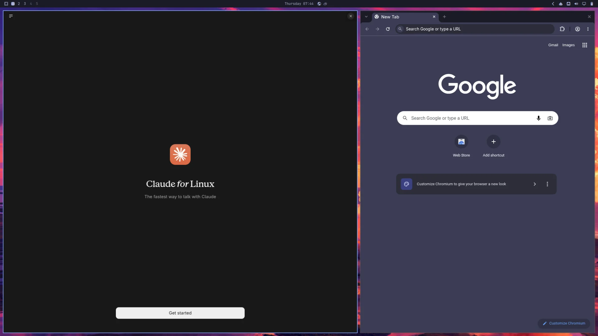
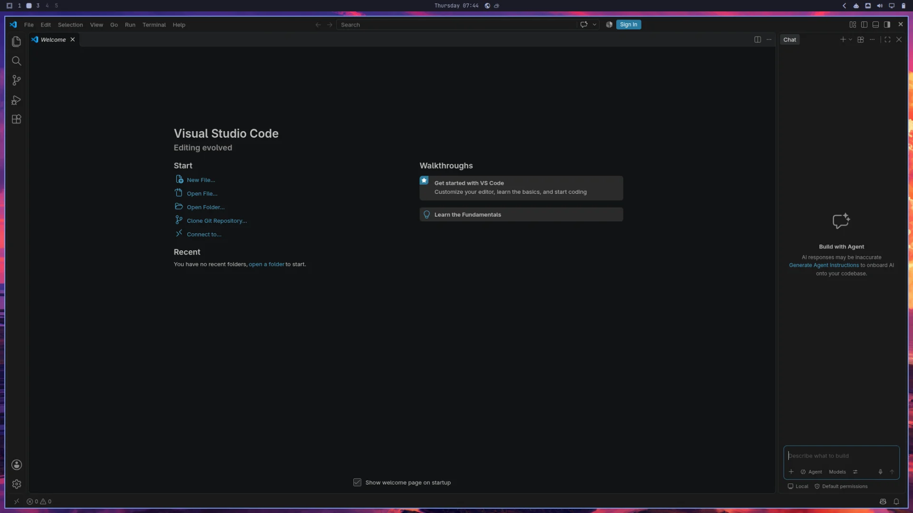
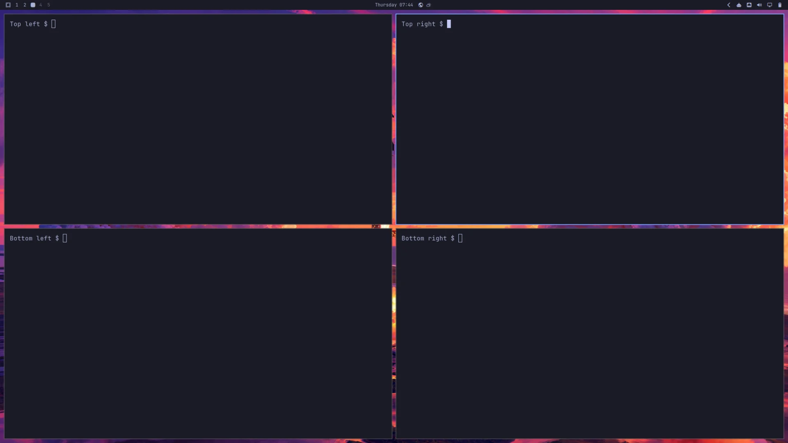

# Claude and browser, VS Code, and four terminals

One layout starts seven windows across three Omarchy workspaces:

| Workspace | Windows |
| --- | --- |
| 1 | Claude Desktop left 60%, Chromium right 40%. |
| 2 | VS Code fills the usable area, with the usual panel clearance and gaps. |
| 3 | Four Foot terminals in an equal 2×2 grid. |

**Workspace 1 — Claude Desktop and Chromium**



**Workspace 2 — VS Code**



**Workspace 3 — four terminals**



Actual captures from one disposable lean ARM64 guest on 5 November 2026,
at native `2080×1170`, scale 1, resized to `1920×1080` for documentation.
The terminal prompts are neutral screenshot labels. No application accounts
were signed in, and no window positions or sizes were changed for capture.
See the [capture notes and manifest](images/layouts/README.md#three-workspace-captures--5-november-2026).

The preset uses the same floating placement rules as the other examples.
Each terminal has a dedicated app ID so its position is independent.
Workspace assignments use `silent` to avoid switching your view as windows
are placed. Switch between these guest workspaces using Omarchy's native
workspace controls.

Open VM Manager on your Apple Silicon Mac and save **Guest Defaults**. Run
one of these commands from the repository root with an unused VM name.

**Official Try Omarchy:** Use the official factory and select the required apps.

```bash
make bootstrap-omarchy-vm VM_NAME="Dev Claude Code" \
  OMARCHY_VM_FACTORY=official \
  OMARCHY_VM_PACKAGES=pkg:claude-desktop,pkg:chromium,pkg:visual-studio-code-bin \
  OMARCHY_VM_LAYOUT_FILE=omarchy/examples/layouts/claude-browser-code-terminals.lua
```

**Lean, mean coding image:** [Build your image](omarchy-layout-factory.md),
then bootstrap with the same apps and layout. Bootstrap handles preparation
and import.

```bash
make bootstrap-omarchy-vm VM_NAME="Dev Claude Code" \
  OMARCHY_VM_FACTORY=.artifacts/omarchy-image/latest \
  OMARCHY_VM_PACKAGES=pkg:claude-desktop,pkg:chromium,pkg:visual-studio-code-bin \
  OMARCHY_VM_LAYOUT_FILE=omarchy/examples/layouts/claude-browser-code-terminals.lua
```

Review the proposal and follow the guest-password prompt. Bootstrap installs
the apps, applies the layout, restarts and checks the guest. Visit workspaces
1, 2 and 3 in VM Manager; sign into Claude when ready.

To customize the arrangement, copy the Lua file into ignored `omarchy/local/`
and select that copy. Each window rule specifies its workspace, size and
position. Layout changes take effect at the next Hyprland login.

This preset passed [live lean-guest validation on VM Manager 0.11.0](omarchy-layouts.md#claude-browser-code-and-terminals-validation--5-november-2026),
including all seven window placements after restart, accelerated hardware rendering
and setup-sudo cleanup. The official-factory variant was not exercised in that run.

[Prerequisites and settings](omarchy-bootstrap.md) · [Checks and recovery](omarchy-validation.md)
