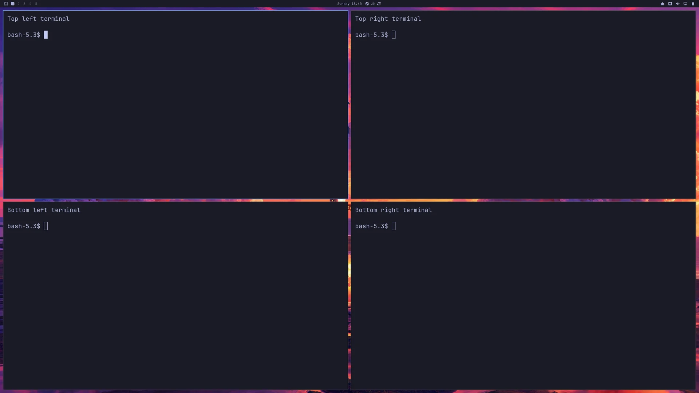

# Four tiled Foot terminals

Four Foot windows in an equal 2×2 grid on workspace 1, with the usual gaps
and top-panel clearance. Each corner has its own terminal title and app ID.
The preset uses floating placement rules, like the other application layouts,
so windows can still be moved and resized manually.



Actual capture from a disposable lean ARM64 guest at native Retina scale 2.
The terminal labels and neutral prompts are for the screenshot.

Open VM Manager on your Apple Silicon Mac and save **Guest Defaults**. Run
one of these commands from the repository root with an unused VM name.

**Official Try Omarchy:** Get running quickly with Omarchy’s standard apps already installed and no image build required.

```bash
make bootstrap-omarchy-vm VM_NAME="Dev Terminals" \
  OMARCHY_VM_FACTORY=official \
  OMARCHY_VM_LAYOUT_FILE=omarchy/examples/layouts/four-terminals.lua
```

**Lean, mean coding image:** Start with a smaller, reusable base and add only the apps and developer tools you need.

[Build your lean, mean coding image](omarchy-layout-factory.md), then use its
path below. Bootstrap handles preparation and import.

```bash
make bootstrap-omarchy-vm VM_NAME="Dev Terminals" \
  OMARCHY_VM_FACTORY=.artifacts/omarchy-image/latest \
  OMARCHY_VM_LAYOUT_FILE=omarchy/examples/layouts/four-terminals.lua
```

Foot is included in both factories; no extra app selection is needed.
Bootstrap applies the layout, restarts and checks the guest. Open workspace 1
in VM Manager.

Review the proposal and follow the guest-password prompt.

Optional check later, using the same VM name:

```bash
make check-omarchy-vm VM_NAME="Dev Terminals"
```

Add `OMARCHY_VM_LEAN_DEVELOPER=yes` to trim optional desktop apps too.

The preset passed [live layout validation](omarchy-layouts.md#four-terminal-validation--1-november-2026),
including reapplication and two restarts.

[Prerequisites and settings](omarchy-bootstrap.md) · [Checks and recovery](omarchy-validation.md)
