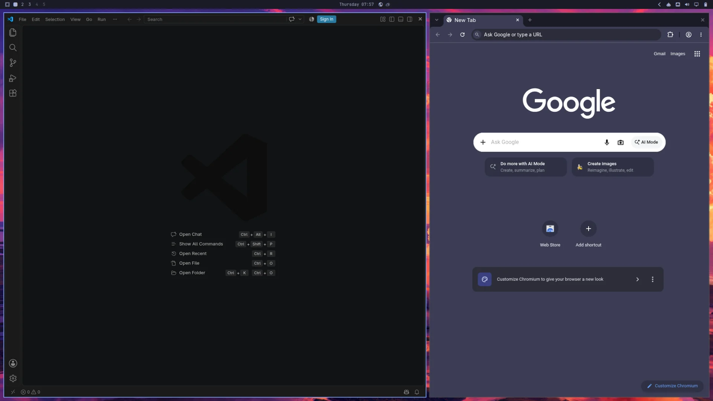
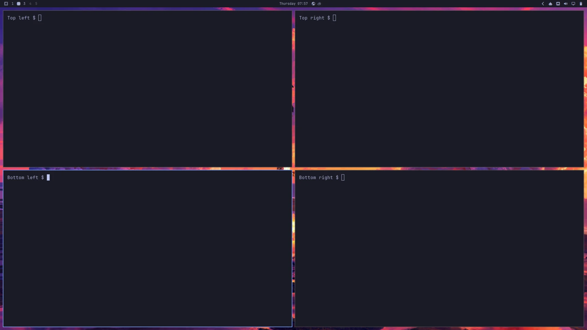
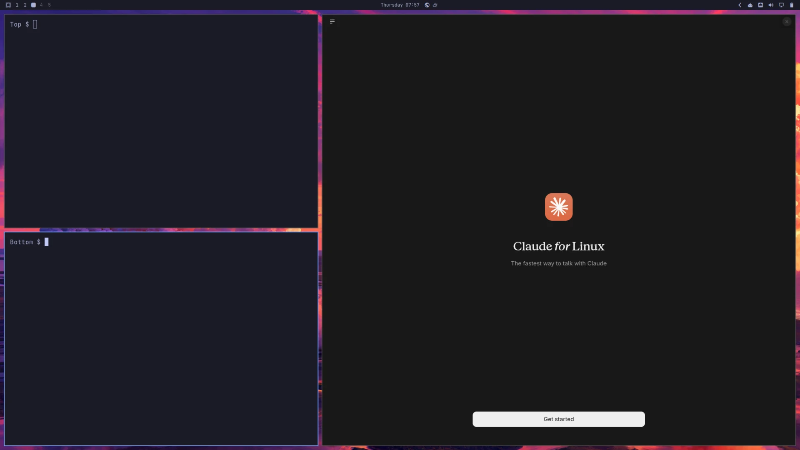

# Multi-workspace workstation

One layout starts nine windows across three Omarchy workspaces:

| Workspace | Windows |
| --- | --- |
| 1 | VS Code left 60%, Chromium right 40%. |
| 2 | Four Foot terminals in an equal 2×2 grid. |
| 3 | Claude Desktop right 60%, two Foot terminals stacked left 40%. |

**Workspace 1 — VS Code and Chromium**



**Workspace 2 — four terminals**



**Workspace 3 — Claude Desktop and two terminals**



Actual captures from one disposable lean ARM64 guest on 5 November 2026,
at native `2080×1170`, scale 1, resized to `1920×1080` for documentation.
The terminal prompts are neutral screenshot labels. No application accounts
were signed in and no window geometry was adjusted for capture. See the
[capture notes and manifest](images/layouts/README.md#original-multi-workspace-captures--5-november-2026).

The preset uses the same floating placement rules as the other examples.
Each terminal has a dedicated app ID so its workspace and position are
independent. Workspace assignments use `silent` to avoid switching your view
as the windows are placed. These are workspaces inside the guest; switch
between them using Omarchy's native workspace controls.

Open VM Manager on your Apple Silicon Mac and save **Guest Defaults**. Run
one of these commands from the repository root with an unused VM name.

**Official Try Omarchy:** Use the official factory and select the required apps.

```bash
make bootstrap-omarchy-vm VM_NAME="Dev Workspaces" \
  OMARCHY_VM_FACTORY=official \
  OMARCHY_VM_PACKAGES=pkg:visual-studio-code-bin,pkg:chromium,pkg:claude-desktop \
  OMARCHY_VM_LAYOUT_FILE=omarchy/examples/layouts/multi-workspace.lua
```

**Lean, mean coding image:** [Build your image](omarchy-layout-factory.md),
then bootstrap with the same apps and layout. Bootstrap handles preparation
and import.

```bash
make bootstrap-omarchy-vm VM_NAME="Dev Workspaces" \
  OMARCHY_VM_FACTORY=.artifacts/omarchy-image/latest \
  OMARCHY_VM_PACKAGES=pkg:visual-studio-code-bin,pkg:chromium,pkg:claude-desktop \
  OMARCHY_VM_LAYOUT_FILE=omarchy/examples/layouts/multi-workspace.lua
```

Review the proposal and follow the guest-password prompt. Bootstrap installs
the apps, applies the layout, restarts and checks the guest. Visit workspaces
1, 2 and 3 in VM Manager; sign into Claude when ready.

To customize the arrangement, copy the Lua file into ignored `omarchy/local/`
and select that copy. Each window rule specifies its workspace, size and
position. Layout changes take effect at the next Hyprland login.

This preset passed [live lean-guest validation on VM Manager 0.11.0](omarchy-layouts.md#original-multi-workspace-validation--5-november-2026),
including all nine placements after restart, window separation, accelerated
hardware rendering and setup-sudo cleanup. Validation found and corrected a
one-pixel overlap between the workspace 3 terminals; they now have the usual
12-pixel gap. The official-factory variant was not exercised in that run.

[Prerequisites and settings](omarchy-bootstrap.md) · [Checks and recovery](omarchy-validation.md)
