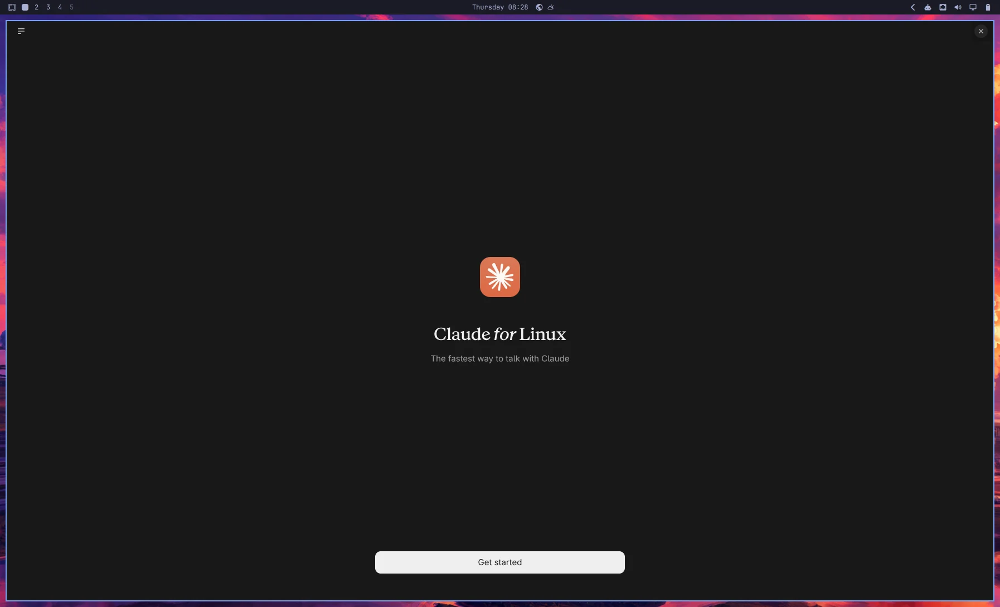
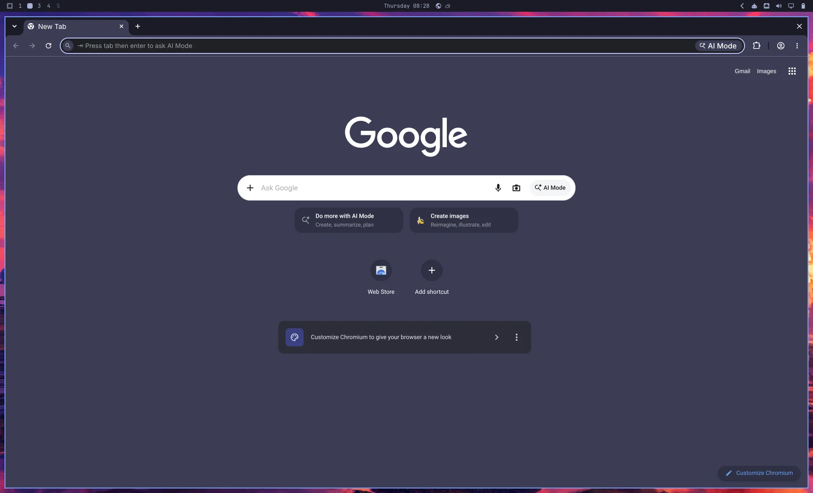
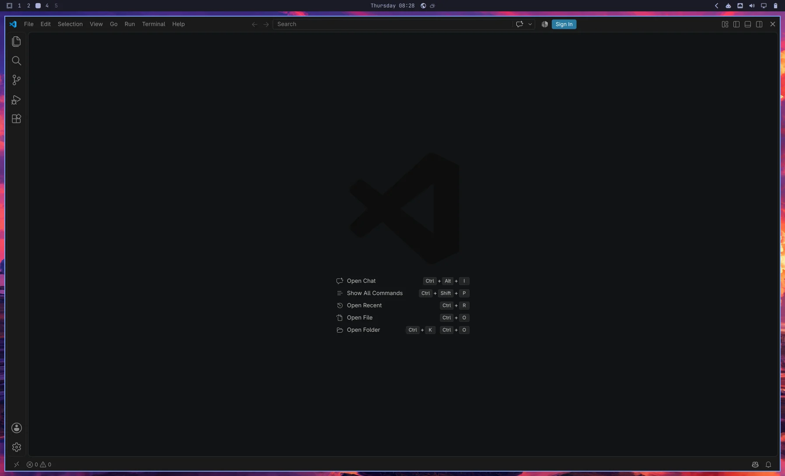
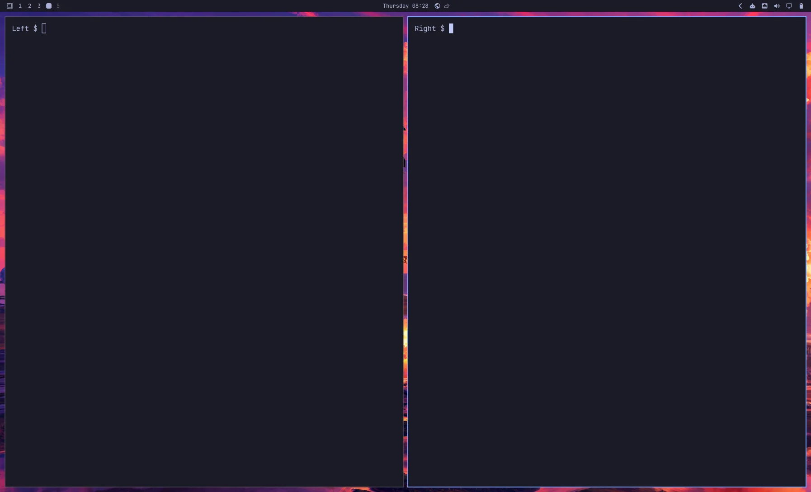

# Small-screen workstation

For one smaller display, such as a MacBook Pro screen, this preset starts
five windows across four Omarchy workspaces:

| Workspace | Windows |
| --- | --- |
| 1 | Claude Desktop fills the usable area. |
| 2 | Chromium fills the usable area. |
| 3 | VS Code fills the usable area. |
| 4 | Two equal-width Foot terminals side by side, both full height. |

**Workspace 1 — Claude Desktop**



**Workspace 2 — Chromium**



**Workspace 3 — VS Code**



**Workspace 4 — two terminals**



Actual captures from one disposable lean ARM64 guest on 5 November 2026,
at a laptop-sized `1794×1089` logical resolution: `3588×2178` backing pixels,
Retina scale 2. The complete frames are saved at logical size for documentation.
The terminal prompts are neutral screenshot labels; no application accounts
were signed in. See the [capture notes and manifest](images/layouts/README.md#small-screen-captures--5-november-2026).

Each workspace uses the available area with the usual panel clearance,
12-pixel outer gaps and a 12-pixel gap between the terminals. The preset uses
floating placement rules like the other examples. Each terminal has a dedicated
app ID, and workspace assignments use `silent` to avoid switching your view as
windows are placed. Switch between the four guest workspaces using Omarchy's
native workspace controls. VM Manager owns the display and Retina scaling.

Open VM Manager on your Apple Silicon Mac and save **Guest Defaults**. Run
one of these commands from the repository root with an unused VM name.

**Official Try Omarchy:** Use the official factory and select the required apps.

```bash
make bootstrap-omarchy-vm VM_NAME="Dev Small Screen" \
  OMARCHY_VM_FACTORY=official \
  OMARCHY_VM_PACKAGES=pkg:claude-desktop,pkg:chromium,pkg:visual-studio-code-bin \
  OMARCHY_VM_LAYOUT_FILE=omarchy/examples/layouts/small-screen.lua
```

**Lean, mean coding image:** [Build your image](omarchy-layout-factory.md),
then bootstrap with the same apps and layout. Bootstrap handles preparation
and import.

```bash
make bootstrap-omarchy-vm VM_NAME="Dev Small Screen" \
  OMARCHY_VM_FACTORY=.artifacts/omarchy-image/latest \
  OMARCHY_VM_PACKAGES=pkg:claude-desktop,pkg:chromium,pkg:visual-studio-code-bin \
  OMARCHY_VM_LAYOUT_FILE=omarchy/examples/layouts/small-screen.lua
```

Review the proposal and follow the guest-password prompt. Bootstrap installs
the apps, applies the layout, restarts and checks the guest. Visit workspaces
1 through 4 in VM Manager; sign into Claude when ready.

To customize the arrangement, copy the Lua file into ignored `omarchy/local/`
and select that copy. Each window rule specifies its workspace, size and
position. Layout changes take effect at the next Hyprland login.

The placement rules size windows when they open. After resizing the VM window
or moving it to a display with different logical dimensions, reopen the apps
to apply the rules at that size. Already-open floating windows keep their
previous geometry; this preset does not automatically refit them.

This preset passed [live lean-guest validation on VM Manager 0.11.0](omarchy-layouts.md#small-screen-validation--5-november-2026)
at the measured laptop-sized Retina viewport after reopening the apps there.
All 43 checks passed, including five exact placements across four workspaces,
no overlap or clipping, accelerated rendering and setup-sudo cleanup. The
official-factory variant was not exercised in that run.

[Prerequisites and settings](omarchy-bootstrap.md) · [Checks and recovery](omarchy-validation.md)
