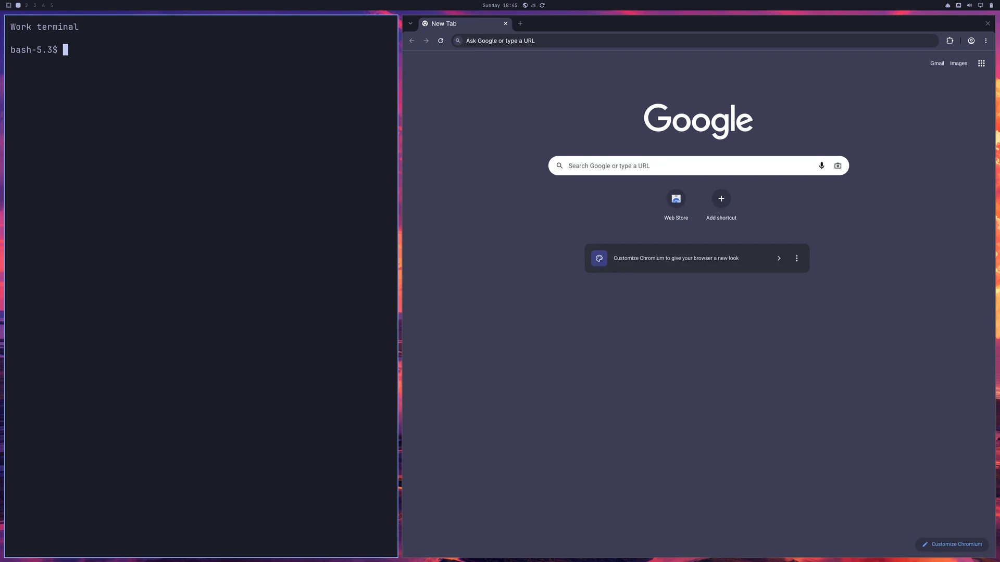

# Terminal and browser

A terminal on the left (40%) and Chromium on the right (60%).



Actual capture from a disposable lean ARM64 guest at native Retina scale 2.
The terminal label and neutral prompt are for the screenshot.

Open VM Manager on your Apple Silicon Mac and save **Guest Defaults**. Run
one of these commands from the repository root with an unused VM name.

**Official Try Omarchy:** Get running quickly with Omarchy’s standard apps already installed and no image build required.

```bash
make bootstrap-omarchy-vm VM_NAME="Dev Terminal" \
  OMARCHY_VM_FACTORY=official \
  OMARCHY_VM_PACKAGES=pkg:chromium \
  OMARCHY_VM_LAYOUT_FILE=omarchy/examples/layouts/terminal-browser.lua
```

**Lean, mean coding image:** Start with a smaller, reusable base and add only the apps and developer tools you need.

[Build your lean, mean coding image](omarchy-layout-factory.md), then use its
path below. Bootstrap handles preparation and import.

```bash
make bootstrap-omarchy-vm VM_NAME="Dev Terminal" \
  OMARCHY_VM_FACTORY=.artifacts/omarchy-image/latest \
  OMARCHY_VM_PACKAGES=pkg:chromium \
  OMARCHY_VM_LAYOUT_FILE=omarchy/examples/layouts/terminal-browser.lua
```

Bootstrap ensures the apps are installed, applies the layout, restarts and
checks the guest. Open workspace 1 in VM Manager.

Review the proposal and follow the guest-password prompt.

Optional check later, using the same VM name:

```bash
make check-omarchy-vm VM_NAME="Dev Terminal"
```

Add `OMARCHY_VM_LEAN_DEVELOPER=yes` to trim optional desktop apps too.

[Prerequisites and settings](omarchy-bootstrap.md) · [Checks and recovery](omarchy-validation.md)
